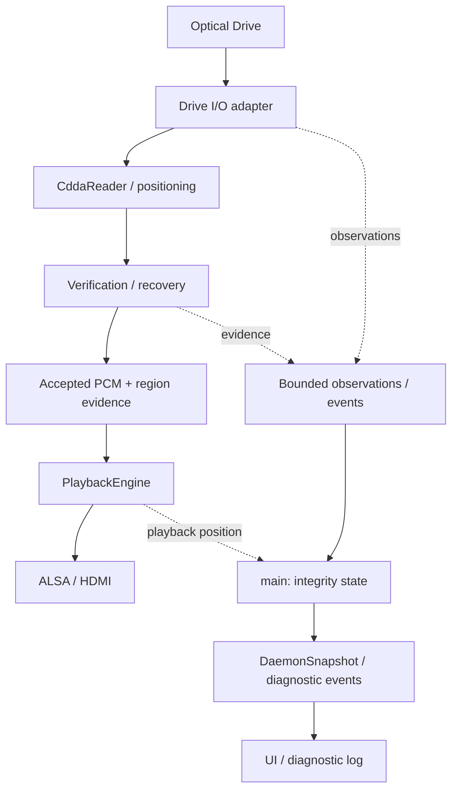
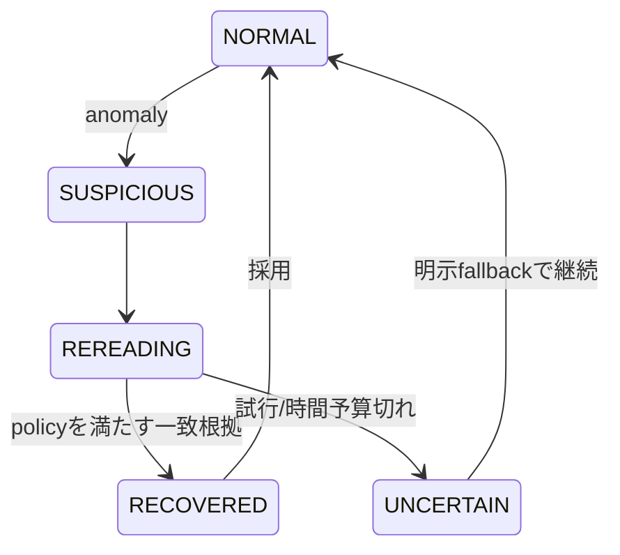

# 読み取り信頼性・説明可能性の仕様

この文書は読み取り信頼性（integrity）の横断仕様であり、基本・機能・詳細設計の一部である。
2026-09-25にDevelopmentの拡張案を統合した。実装済みの契約は
[機能設計](functional-design.md)と[詳細設計](detailed-design.md)、実機確認範囲は
[検証状況](../development/verification.md)を参照する。

以下では、継続して守る原則と未実装の要求を定義する。未実装の要求を統合したことは、
現在のCLI/APIで利用可能になったことを意味しない。型名・追加JSON field・endpoint名・
上限の候補値は明示したとおり暫定であり、公開前に互換性と実測を基に確定する。

## 実装との対応

| 区分 | 内容 |
|---|---|
| 実装済み | read-only能力probe、UNKNOWNモデル、区間付きReadEvidence、stream世代、ALSA再生head推定、bounded event、technical status |
| 実装済み | 先読み容量・開始閾値、drive access直列化、single/repeat、ReadPolicyの停止境界でのruntime適用 |
| 実装済み | direct backendのC2 pointer opt-in、capabilityに応じたsingle/repeat strategy選択とdowngrade reason公開 |
| 未実装の要求 | cache軽減を伴う独立性、C2 trust評価、offset、追加mode、外部照合 |
| 未確定の詳細 | cache対策手順、mode既定値、照合サービス・依存library |

現在の公開型は[ReadEvidence / ReadDiagnostics](../../include/integrity_state.hpp)、
[DriveCapabilities](../../include/drive_capabilities.hpp)、[ReadPolicy](../../include/read_policy.hpp)、
[PlayerEvent](../../include/player_event.hpp)を正とする。後述の拡張モデルと同名でも同一の契約とは限らない。
現在のeventはREAD_OBSERVEDで、`WS /api/events`はsnapshot配信である。
device/disc generation、policy revision、128件の詳細履歴、stream coverage、256区間のdisc mapは公開済み。独立した完全replay用diagnostic streamは提供しない。

未実装項目の着手・進捗・完了条件は[残課題一覧](../development/backlog.md)で追跡する。
phase番号は段階の対応付けであり、phaseの一部分を実装しただけで全体を完了とはしない。

## 1. 目的と原則

「現在再生しているPCMを、どの観測と検証に基づいて採用したか」を説明する。
音質改善や原PCMの完全な復元を主張する機能ではない。
優先順位はcorrectness、truthfulness、explainability、drive independence、graceful degradation、
playback continuity、quiet operation、extensibility、UI simplicityとする。

- read成功は証拠であり、正しい原PCMの証明ではない。
- C2非検出、複数read一致、外部照合成功、offset補正は別々の事実である。
- capability UNKNOWNをNOへ、offset不明を0へ変換しない。
- backend名やSECUREという設定だけを根拠に「検証済み」と表示しない。
- UI/診断接続の停止・遅延がaudio処理を待たせてはならない。
- 不明・未解決・代替PCMの使用を隠して再生継続を成功扱いにしない。

## 2. 現行実装と追加要求の境界

観測core、technical status、先読み設定、drive access直列化、任意の反復一致は現行設計へ統合した。
追加要求の中心はC2 trust評価、cache独立性、offset、追加mode、外部照合である。direct C2 pointerは
明示opt-inで、capabilityに応じた現行single/repeat strategy選択とdowngrade reasonを公開する。
ReadPolicyの稼働中切替は実装・自動試験済みで、
通常CDでPLAYING/PAUSED中の保留とSTOPPED境界での適用を確認した。現在の小さなReadPolicyと、
以下の全要素を備えた将来policyは区別する。

初期の依存調査では観測coreへの新規libraryは不要だった。MMC/C2/cacheはLinux UAPIと
drive/bridgeの挙動を確認してから選び、外部照合のprotocol・利用条件は着手時に再調査する。
追加要求の統合だけを理由に既存reader、ALSA、CEC、metadataを再設計しない。

## 3. 目標構成と所有権

以下は未実装部分も含む目標構成である。現行の所有権を保って段階的に拡張する。



Drive Adapterは責務の境界であり、初期段階で全backendを巨大なclass階層へ置き換えない。
既存LinuxIoctlReaderのtransport callback、MediaWorkerのcallbackをprobe/試験の差し替え点に使う。
vendor/model固有の対応が必要になったらadapter側へ閉じ込め、適用条件と根拠を公開する。

PCM reader・検証器はPcmWorker側、PlayerStateと公開integrityはmain側で所有する。
検証はPCMを採用する前の処理であり、UIとは独立。観測は小さな値をqueueで渡す。
既存TOC、metadata、CEC、ALSAを別のlibraryへ移さない。追加thread poolは不要。

## 4. 拡張データモデル（未実装部分を含む）

ここでの名称は目標モデルの責務を表す。現行型への追加方法・公開名は実装時に確定する。
既存PlaybackStateを再定義しない。

| 型 | 主な情報・寿命 |
|---|---|
| CapabilityValue<T> | optional value、evidence一覧、観測時刻、適用範囲、probe error |
| DriveCapabilities | identity、DAE、C2 support/trust、cache、accurate stream、speed control、offset |
| DriveState | device generation、接続/probe状態、要求速度・報告速度・実測throughput |
| ReadPolicy | 希望する検証、時間/試行予算、buffer、未解決時動作 |
| ReadStrategy | 選択された手順、使用backend、利用可能な観測、降格理由 |
| ReadState | IDLE/READING/VERIFYING/RECOVERING/BUFFERING/FAILED、read対象区間 |
| RegionIntegrity | 区間、観測・比較・独立性、offset、採用理由、policy revision |
| IntegrityStats | 試行数、採用区間、recovered/uncertain量、外部照合範囲 |
| ReadProvenance | 問題区間のReadAttempt一覧、採用候補、比較とfallbackの理由 |
| PlayerEvent | machine-readable type、severity、presentation、世代・区間・payload |

bool能力はYES/NO/UNKNOWN。数値不明はnull。根拠はKERNEL_REPORTED / DRIVE_REPORTED /
TESTED / DATABASE / USER_CONFIGURED / INFERREDを区別し、raw根拠と試験条件を残す。
相反する根拠も一方を消さず保持し、採用した判断を示す。TESTEDは条件内での確認であり永久保証ではない。

RegionIntegrityは一次元scoreにせず、次の軸を独立に持つ。

| 軸 | 値案・意味 |
|---|---|
| read_status | UNKNOWN / CLEAN / RECOVERED / UNCERTAIN。CLEANは利用できた観測で異常なし |
| local_verification | NONE / SINGLE_READ / BACKEND_REPORTED / MULTIPLE_MATCH。比較対象範囲と回数を併記 |
| read_independence | UNKNOWN / CACHE_POSSIBLE / CACHE_MITIGATED。物理再読込の保証とはしない |
| external_verification | NOT_CHECKED / UNAVAILABLE / MATCH / MISMATCH、照合方式・範囲・confidence |
| offset_status | UNKNOWN / UNCORRECTED / CORRECTED、値・source・補正範囲 |
| c2_status | UNKNOWN / NOT_AVAILABLE / NOT_CHECKED / CLEAN / REPORTED |
| sample_origin | READ / SILENCE / INTERPOLATED。置換した区間を明示 |

C2非対応、C2取得を行っていない、取得したが非検出、を区別する。
paranoiaのverify/fixup callback件数をMULTIPLE_MATCHや訂正sector数に直接変換しない。
現行のBACKEND_REPORTEDは「libraryがこの種類のcallbackを報告した」までをevidenceとする。

## 5. 再生位置と根拠の対応

先読み中のLBA、queue内の採用済みLBA、ALSAへ送信済みLBA、再生位置推定値を分ける。
future regionのrecoveryを、現在聞こえるPCMのrecoveryとして表示しない。

PcmBlockへ軽量なregion evidenceまたは有効な参照を付け、部分ALSA write後も範囲を保持する。
一つのblock内で状態が違えば半開区間[start_lba,end_lba)へ分割する。
offset補正後の細かな境界はstereo sample frame単位で併記する。
ALSA delayで消費済みと判定するまで送信済みregionの根拠を保持し、current integrityを引く。
出力device以降のTV/ARC/アンプの遅延やbit一致はこの位置推定と保証の対象外。

device generation（再接続）、disc generation（観測した交換）、stream generation（seek/再開）、
policy revisionを明示し、古いPCM・観測・検証結果を現行状態へ適用しない。
UNKNOWNな区間をtrack全体のCHECKED表示で覆わない。track集計は検査済みcoverageと未検査coverageを持つ。
同じsectorの再試行はattempt数へ、distinctな採用sectorはcoverageへ計上して重複加算を避ける。
seekでcoverageに穴がある場合、track checksum完成とはしない。

## 6. PlaybackMode / ReadPolicy / ReadStrategy

`PlaybackMode → ReadPolicy + DriveCapabilities + backendの観測能力 → ReadStrategy`とする。
direct/paranoiaはbackendでありQUIET/BALANCED/SECUREとは別。paranoiaを選ぶだけでSECUREとはしない。
現行snapshotのrequested_mode=LEGACYとsingle/repeatのReadPolicyを維持し、
QUIET/BALANCED/SECUREを利用可能なmodeとしてCLI/APIで受け付けない。
現行snapshotは`read.strategy`にrequested/effective、pending、downgrade reasonを公開する。effectiveは
現在readerへ適用済みの構成であり、requestedとの差はstream途中でreaderを切り替えない境界を表す。
C2 pointer要求ではprobe前・support=UNKNOWN・support=NO・probe結果が現行streamへ未適用を区別する。
これらはC2 trustやPCM品質を表さない。QUIET/BALANCED/SECUREなど追加modeのstrategyは未実装である。

| 未実装mode | 目標policy |
|---|---|
| QUIET | 騒音と連続再生優先。取得可能な異常時だけ限定retry。無検証を検証済みとは表示しない |
| BALANCED | 通常区間は軽量な観測/overlap、疑わしい区間だけ追加read。将来default候補 |
| SECURE | 同一区間の複数read・cache対策・整列比較を優先。必要ならbuffering待機 |

ReadPolicy候補はminimum_matching_reads、maximum_attempts（初回込み）、region_time_budget_ms、
preferred_speed、noise_priority、target_buffer_frames、startup_buffer_frames、overlap_frames、
c2_policy、cache_policy、allow_playback_stall、unresolved_data_policyとする。
desired_confidenceは手順への要求であり、根拠のない確率値では表さない。
retry回数・比較回数・library内部retryを分け、二重retryで予算が膨張しないようbackend別に計上する。

未解決時の設計候補はSTOP / BEST_AVAILABLE / SILENCE / WAIT_WITH_BUDGETだが、
現行に選択肢が4つあるわけではない。#156の判断と境界は[Unresolved PCM Policy](#unresolved-pcm-policy)を参照する。

現行single/repeatの未解決時方針はSTOPである。read error、短いread、またはrepeatの候補不成立では、当該PCMをqueueへ入れず、workerをFAILEDにしてPlaybackEngineがSTOPへ遷移する。古いblock、未初期化buffer、推測したPCM、無音を代替として出力しない。seek、stop、eject、disc世代変更はworker generationを切り替え、以前のstreamのPCMやpolicyを次のstreamへ混在させない。このSTOPはC2 trustや原盤一致の判定ではなく、未解決PCMを成功として再生しないための現在の安全境界である。

BEST_AVAILABLE、SILENCE、WAIT_WITH_BUDGETは今回採用しない。現行CLI/APIは受け付けず、
代替PCM・追加WAIT・新modeを実装しない。将来再検討する場合も、以下の採用前条件を満たす必要がある。

### Unresolved PCM Policy

2026-10-16、#156の設計判断としてSTOPを既定かつ唯一の実装済み方針のまま維持し、
他3候補は現時点で採用しないことを利用者が承認した。永久禁止ではなく、採用理由と安全性を
再評価できる条件を残す。#11のSTOP実装とPR #154、移管を記録したPR #157を変更する判断ではない。

#### 現行STOPの適用境界

- 未解決とは、read error、短いread、repeatの必要一致数未達、overlap不一致等により、
  現行readerが当該要求の完全な採用PCMを返せないことをいう。workerは当該blockをqueueへ入れず停止する。
- read evidenceのUNCERTAINは根拠の分類であり、採用失敗と同義ではない。完全なreadがretry等でUNCERTAINに
  分類されても、現行policyが採用する経路は変えない。これをBEST_AVAILABLEの実装済みと扱わない。
- STOPでは未解決区間へ新たに採用するPCMがなく、そのsample originを原音・無音・推測PCMとして発明しない。
  失敗時は先読みqueue・保持block・出力待ちPCMも破棄し得る。欠損の直前まで必ず聴ける保証や、
  HDMI/ARC/アンプまで瞬時に無音になる保証ではない。
- 反復・時間予算は既存ReadPolicyのまま（既定2一致、最大3試行、10秒）。新しい外側retry予算を追加しない。
  進行中kernel ioctlは強制中断せず、main loopでの停止とreader所有threadによる後からの解放を区別する。
- session、reader-open device generation、disc/stream generation、policy revisionの有効条件を維持する。
  seek/stop/eject/世代変更後の遅延PCMを採用せず、前streamのblockを失敗区間の代用品にしない。
  STREAM根拠の失効と同disc世代のDISC観測は別scopeであり、stream切替だけでdisc観測を破棄する意味ではない。

#### 候補比較と不採用理由

以下の条件は将来の採用前要件であり、現行機能・利用可能な設定値ではない。
未採用案の数値上限や新field名を既定値として追加せず、採用を再検討する時に確定する。

| 候補 | 想定するPCMの由来・適用前提 | 試行/時間上限と最終動作 | 今回の判断理由 |
|---|---|---|---|
| STOP | 採用不能な要求には代替PCMを提出しない | 現行reader予算内で解決しなければSTOP。ioctl中断成功は主張しない | 継続。未解決PCMを成功として出力しない境界を既存実装・試験で説明できる |
| BEST_AVAILABLE | 同一世代・論理区間・offset条件で実際に取得した完全初期化済み候補だけ。検証条件未達を明示し、候補なしはSTOP | 現行read予算を超える試行を暗黙に足さない。候補の保持数・bytes・選択規則を固定し、不適格ならSTOP | 「最良」を選ぶ根拠と、検証不足PCMを出力する製品要求が未確定。click/異音等の評価もない。一致閾値未達の最多票やC2 reportだけで品質最良としない |
| SILENCE | 新規に合成したzero PCM。実CDに記録された無音と区別し、未取得区間を取得済みにしない | 置換可能な区間長・連続回数・合計時間を有限に定め、上限または位置不明ならSTOP | 原音を欠いたまま進捗が進む。sample origin・欠損量・再生位置・復帰時の連続性を利用者へ伝える契約と聴感評価がない |
| WAIT_WITH_BUDGET | 待機そのものはPCMの由来ではない。成功後に採用する実read PCM以外を出力せず、待機を無音挿入として扱わない | 同一未解決区間の単一deadlineと残attemptを共有し、再開ごとに予算をresetしない。期限切れはSTOP、停止/世代変更は旧待機を無効化して遅延結果を捨てる | 既存repeat/read-stall予算との二重化、buffer枯渇時の出力・進捗停止の仕様が未確定。ioctlを中断できず、単なる待機追加で連続再生を保証できない |

BEST_AVAILABLEが実際に読んだ候補であっても、原盤一致・cache独立性・現行policyの検証成功は別である。
候補の一部を古いPCMで埋めたり、未初期化bufferを採用したり、根拠のない補間で「原音」を推測しない。
SILENCEを将来採用するなら、合成区間はUNCERTAINかつ合成由来と明示し、取得済み/検証済みの集計へ入れない。
いずれも全track/disc取得、checksum完成、外部MATCHへ読み替えない。完全取得入力の適格性は#160で別途定義する。

#### メッセージと表示の境界

現行ReadPolicyのC++型と公開JSONに`unresolved_data_policy`や`sample_origin`というfieldはない。
本節の語は仕様上の方針・由来の概念であり、新しいenum、event、REST/WS field、Settings選択肢や
fixture値を導入しない。[現行メッセージ契約](message-contract.md#unresolved-pcm-policy)の範囲で表示する。
失敗readのUNCERTAINや候補間の一致回数だけから、PCMが採用・提出されたと推定してはならない。

将来の代替出力には、要求した方針/実際の動作、理由、論理区間、実際に読んだ/合成したPCMの由来、
採用量と欠損量、検証不足をsnapshot・event・詳細履歴・Custom UIで一貫して説明する契約が必要である。
WAITでは待機中と再生中を区別し、期限・残予算・最終動作・進捗の扱いを定義する。
既存のCLEAN/RECOVERED/UNCERTAINやstrategy降格理由だけに新しい意味を押し込まない。
field名・型・単位・欠損時・世代・有界保持・旧client互換性は採用前に確定し、今回の公開表へ先取りしない。

#### 他の停止・復旧との区別

#10の端で取得不能な区間とalignment除外は再生前に計算するwindow制限であり、代替PCMや
read failureからのfallbackではない。予定window終端の正常drainと、未解決時のエラー停止を区別する。
#34のread-stall監視とALSA underrun復旧も本Issueでは変更しない。後者は出力経路の再bufferであり、
未解決PCMへの代替やintegrityのRECOVEREDを意味しない。C2 packet failure後の通常readも、
実CDのPCMを再取得するbackend経路であり、SILENCE等の追加出力方針とは別である。
物理USB消失・resetの検出は#88、異常媒体や別driveの実証は#146に残す。

#### 再検討と独立実装の条件

連続再生のために検証不足PCM・合成・待機のどれを許容するのか、利用者の製品上の要求が生じた時だけ
候補を再検討する。具体的な方針、上記の有限上限・最終STOP、公開契約、聴感/操作の受入条件を
別途承認してから、採用する候補に限定した独立実装Issueを作る。今回は採用候補がなく、後続実装Issueを作らない。

| 将来の検証条件 | 最低限確認すること |
|---|---|
| read error/partial/候補なし/一致不足/overlap不一致 | STOPとの出力差、採用/非採用の区間・根拠、初期化済みbufferだけを使うこと |
| retry・repeat・deadline | backend内部retryと方針のattemptを区別し、単一予算、上限でのSTOP、戻らないioctl時のmain-loop応答を確認 |
| stop/seek/eject/disc・reader・policy世代変更 | 待機/候補/出力途中の取消、旧PCM・旧結果の拒否、root sessionとの照合 |
| 出力とcoverage | 有効PCM、検証不足候補、合成、無出力を区別し、提出/消費位置と取得/検証coverageを混同しない |
| REST/WS/history/Custom UI | 欠損・unknown・履歴eviction・再接続でも、表示から原音一致や採用成功を推測しない |
| 構成/実機 | API無効を含む再build・回帰、test-only fakeでの全sampleと有界性、別承認の実機音声/操作評価。fake成功を物理傷やC2 trustの保証にしない |

この設計判断は代替PCM機能の実装・自動試験・実機確認の完了ではない。現行STOPの実装を変えない。
文書整理後、利用者からcommit・push・master統合を別途承認された。Issue状態変更・配備は含めない。

## 7. NO DISCでの能力probe

現行probeはread-onlyかつ任意失敗可能。discなしでも取得できる情報だけを返す。
probe failureはcapability NOではなくUNKNOWN+error。probe成功を再生可能化の条件にしない。
現行では起動時にMediaWorkerへ一度投入し、同workerの後続media処理はprobe完了を待つ。
非同期であることはprobeの遅延がdisc認識へ影響しないという保証ではない。

| 情報 | 取得候補と扱い |
|---|---|
| vendor/model/firmware | 現行はsysfs device/vendor, model, revから取得。欠落は不明として扱う |
| kernelが公開する機能 | CDROM_GET_CAPABILITY。driver/interface側の根拠として保持 |
| DAE | 後続phaseでMMCのreportを調査。成功したAudio readはTESTEDとしてその条件を記録 |
| C2 support | MMC `GET CONFIGURATION`のfeature descriptor一覧にあるCD Read Feature（0x001e）のC2 Flagsを`CDROM_SEND_PACKET`で読む。成功時だけDRIVE_REPORTEDのYES/NO。実測trustおよびread時のC2観測とは別管理 |
| accurate stream/cache | 後続phaseでMMC inquiry/mode page等を調査。reportと実測trustを別管理 |
| speed control | CDC_SELECT_SPEEDはkernel report。実際の設定可否・効果は別途確認 |
| supported/current speed | 未取得ならUNKNOWN。要求2xやread所要時間からcurrent speed=2xと断定しない |
| read offset | 未指定はUNKNOWN。起動時の明示値だけUSER_CONFIGUREDで適用。vendor/modelから推定せず、校正/database取得は未実装 |

Linux CDROM_GET_CAPABILITYにはC2 trustやoffsetの直接的な情報はない。
CDC_PLAY_AUDIOをDAE成功の証明として使わない。
CDROM_SELECT_SPEEDは設定操作なので現行のprobeでは実行しない。
C2 supportの初期probeは`CDROM_SEND_PACKET`で読み取り専用の`GET CONFIGURATION`から最大512 byteの
feature descriptor一覧を取得する。command failureまたは不正な応答はUNKNOWN+`probe_error`にし、NOへ
変換しない。Featureが不在という有効な応答だけはDRIVE_REPORTEDのNOにする。応答が上限を超える場合も
UNKNOWNとして扱う。generic packet対応だけで全MMC機能が使えるとはしない。

probeはMediaWorkerで逐次実行し、drive I/OはPCM readerと直列化する。
待機中はUNKNOWNを公開する。hotplug/reset時の能力snapshot無効化・再取得、driveなしとdiscなしの
lifecycle分離は#88の責務であり、#7の初回probeへ含めない。現在はdevice generationによる失効・再probeを実装していない。
速度変更・cache対策の追加前にdevice I/Oの調停を整え、ejectを優先する。
現行probeに能動的cache/C2精度試験やトレイ操作は含めない。

確認資料: 実機の`/usr/include/linux/cdrom.h`、`/usr/include/scsi/sg.h`、
[Linux CD-ROM ioctl](https://docs.kernel.org/userspace-api/ioctl/cdrom.html)、
[Linux SCSI Generic](https://docs.kernel.org/scsi/scsi-generic.html)。
これらはLinux入口の確認であり、MMC全機能やこのASUS driveの能力を確認したものではない。

## 8. bufferと検証・recovery

既存bounded dequeを維持し、必要性が実測で示されるまでring bufferへ置き換えない。
容量と開始閾値はCD frame単位で扱い、read regionの長さと分離する。
現在のsingle/repeatのread量とbufferの既定値は機能設計を参照する。
BALANCEDの10〜30秒は評価候補であり、今すぐ既定値にしない。
PCM単体は176400 bytes/秒なので10秒約1.68 MiB、30秒約5.05 MiB。
比較用候補・overlap・provenance・ALSA bufferの予算も別途上限を持つ。
buffered時間はqueue・engine未送信分・ALSA delayを分け、二重計上しない。

現行repeat verifierは既存seek/readを包み、最初の論理block以外で直前に採用した15 CD frameを先行overlapとして読む。
overlapは出力に含めず、直前PCMとの一致を確認する。比較対象がないstream開始/seek直後は`STREAM_BOUNDARY`、
不一致はfail-closedである。候補PCMは最大8、overlapは最大75 CD frameに制限する。
今後cache軽減を実装する場合も既存seek/readを包むverification layerから必要な前後区間を読む。
paranoiaの連続読み取り状態を壊すstateless read_regionへの全面変更は行わない。
overlap/複数readを提供できるbackendの組合せを明示し、使えないstrategyは降格する。
比較前にbyte order・サンプル位置・offset条件を統一し、overlap分を二重再生しない。
disc端を越える読込は要求せず、検証不能な端区間を明記する。



UNCERTAINからSTOPするpolicyもある。overlap不一致は不連続の疑いであり、欠落/重複の原因を即断しない。
CRCは候補グループ化・診断用。可能なら最終的な一致判定はPCM全bytesで行い、CRC衝突を同一視しない。
「3回一致」は回数と比較条件を示す。single readの独立性はUNKNOWN、現行repeat verifierの採用結果はCACHE_POSSIBLEである。
cache defeatやdistant readをしただけで物理再読込を保証したとはしない。

offsetは正負付きstereo sample frame単位（両channelで同じ時間位置）とする。
採用databaseの符号規約を明記し、補正で必要な端データが読めない場合はその範囲を不明/代替扱いにする。
speed設定非対応ならdrive既定、C2不可なら利用可能なoverlap/repeated read、offset不明なら未補正で再生する。
ALSA underrun復旧は出力継続の処理であり、read integrityのRECOVEREDとは別のeventと統計にする。
同じstreamでは最大3回まで再生位置からreaderを再生成して再開し、上限到達時は停止する。これは
read errorの再試行方針や未解決PCMの扱いを変更しない。

### Offset入力・校正契約（#162の設計、#10の実装）

#162はPR #161で入力・校正契約の文書化として完了した。そのClosedは補正実装の根拠ではない。
#10の今回差分でCLI、reader補正、根拠公開、fake PCM試験を実装し、限定的なPi確認を別に記録した。

`read_offset_samples`はstereo sample frameの符号付き整数とする。論理PCM位置を`p`、
設定offsetを`o`としたとき、補正後に論理位置`p`へ置くPCMは物理reader位置`p + o`から得る。
従って`o > 0`は後方の物理PCMを前倒しにし、論理要求の末尾より後の入力を必要とする。
`o < 0`は先頭より前の入力を必要とする。この規約をdatabaseや校正値の規約と比較せずに
値だけ取り込まない。1 CD frameは588 stereo sample frameなので、補正はCD frame境界に
揃わない値を含み得る。

初期入力は`--read-offset-samples SIGNED_INTEGER`であり、`/etc/default/picdplayer`の
既存`PICDPLAYER_EXTRA_ARGS`からも渡せる。対象は`--player`だけで、起動時に符号付き32-bit整数として
構文とoverflowを検証する。実装はdiscのaudio範囲と一回のreader要求から安全に扱えない値を拒否し、
任意の上限値を黙って丸めない。現行入力はdaemon再起動でだけ変更でき、stream途中やruntime Settingsでは適用しない。

未指定は`read_offset_samples=null`、`offset_status=UNKNOWN`であり、0へ読み替えない。明示した0も
校正値として公開する。値を実際に適用したreadは`CORRECTED`、値が判明しても適用されないreadは
`UNCORRECTED`とする。公開値にはUSER_CONFIGUREDの根拠と物理校正未検証のdetailを伴わせる。
TESTED / DATABASE由来の値を取得する機能は未実装である。明示ユーザー値は将来の
校正・database値より優先し、利用条件・機種/firmware一致・符号規約を検証できないdatabase値は
自動採用しない。

補正入力がdiscのaudio範囲外となる先頭・末尾は、ゼロ埋め・繰返し・推定PCMを生成しない。
その論理区間はcoverage不足として結果・外部checksum入力から除外し、全域照合をMATCHにしない。
seek、disc generation変更、read error、代替PCMも同様にcoverageを途切れさせる。実装時は
正負offset、非frame境界、disc端、partial read、repeat overlap、disc交換をfake PCMで検証し、
校正値の物理確認は#146で別途記録する。

### #10の採用仕様と実装

2026-10-16、Dと追加wire契約の仕様採用、実装・自動試験、Debug配備・限定実機試験を順に承認して進めた。
以下は今回実装した契約であり、A/B/Cは比較の記録として残す。未指定は従来どおりnull/UNKNOWNである。
自動試験と限定的なPi確認は[検証記録](../development/verification.md#10-read-offsetの実装と限定実機確認2026-10-16)を参照し、
物理校正・原盤一致・試聴・全disc完走まで確認済みとは扱わない。

#### 入力と適用

- `--player`限定の`--read-offset-samples SIGNED_INTEGER`を起動時だけ受け付ける。
  十進整数の先頭の`+`/`-`を許し、空・符号だけ・小数・末尾文字・32-bit overflowは起動前に拒否する。
  `/etc/default/picdplayer`からは既存の`PICDPLAYER_EXTRA_ARGS`で渡し、新しい保存schemaやSettings操作は追加しない。
- 未指定はnull/UNKNOWNで従来のread経路を維持する。明示0は既知の値であり、適用成功したreadはCORRECTEDとする。
  値のsourceはUSER_CONFIGURED、detailは明示入力であって物理校正を検証していないことを説明する。
  値の入力だけでTESTED、原盤一致、外部MATCH、C2 trustを成立させない。
- 設定はdaemon起動中に変更しない。変更には再起動を必要とし、reader再生成時も同じ設定を使う。
  CLIの構文検証と、TOC受理後のaudio範囲に対する検証は区別する。discがない起動を失敗させない。
  全audio範囲より絶対値が大きいか等しいoffsetは有効な補正区間を持たないため、TOC受理後に理由付きで再生を拒否する。
  不正値を丸めたり0へ戻したりしない。範囲計算は符号付き64-bitで行う。

#### 座標と取得範囲

sample位置はdisc先頭からの相対値でなく、LBAに588を掛けた絶対stereo sample frame位置とする。
TOCのaudio範囲を`[B,E)`、論理要求を`[p,p+n)`、offsetを`o`とすると、必要な物理PCMは
`[p+o,p+n+o)`である。補正可能な論理範囲は`[B,E)`と`[B-o,E-o)`の共通部分となる。
要求のうちこの共通部分に含まれない区間を、端で取得不能なsample区間として明示する。

例えばaudio範囲が`[0,5880)`なら、`o=+1`では論理`[0,5879)`が補正可能で末尾1 sampleが不足する。
`o=-1`では論理`[1,5880)`が補正可能で先頭1 sampleが不足する。`o=+588`なら末尾1 CD frameが不足する。
内部track境界にはdisc端と同じ欠損を作らず、隣接audio trackから必要なPCMを取得できる。
pregap、lead-in/out、負LBA、mixed-modeへの対応は追加しない。

物理要求はsample範囲を含むCD frameへ外側に丸める。開始は`floor((p+o)/588)`、
終了は`ceil((p+n+o)/588)`とし、取得後に前後の余分なsampleを除く。
全要求がaudio範囲内なら、CD frame整数個の論理要求に必要な物理frame数は論理frame数かそれより1多い値になる。
offsetの絶対値分のpaddingを確保しない。要求量・追加1 frame・repeat候補数からmemoryを有界にし、
sizeの積算とLBA変換時にもoverflowを拒否する。実際のI/Oは既存DriveAccessCoordinator内で行う。

#### 端区間の選択肢と推奨案

| 案 | 再生への影響 | 今回の判断状態 |
|---|---|---|
| A: 要求全量を作れなければ非採用・STOP | 負offsetで先頭再生不可、正offsetで末尾前STOPになり得る。1 sample不足でもblock・先読みqueue・出力待ちPCMへ影響する | 初期仕様には非採用。最初に提示した最小変更案として記録を保持 |
| B: 補正可能なsample範囲だけを再生 | 先頭/末尾が短くなる。sample単位の開始・終端・進捗・drain契約が必要 | 初期仕様には非採用。必要になれば追加設計と承認を要する |
| C: 端だけ未補正または代替PCMで継続 | 補正条件やsample originが区間で変わる。無音等は#156の採否にも関係する | 今回は採用を提案しない。自動fallbackを実装しない |
| D: 補正可能な完全CD frameだけを再生 | Bを内側のCD frame境界へ丸める。物理的な不足に加えて最大587 sample frameを除外するが、既存の整数CD frame契約を維持できる | 採用・実装、fake PCM成功。USB異常等による停止履歴を残し、利用者確認後に最終packageのPi 6条件成功。校正・試聴は未確認 |

Aでは、範囲外I/Oを発行せず、当該要求を失敗としてPCMをqueueへ入れない。
既存read failureと同じ停止経路を使う案であり、block途中までを必ず聴ける、または不足sampleの直前で
正確に停止する保証ではない。既存workerが未提出queueを破棄する影響も含む。正常なdisc終端drainとは区別する。
`PcmWorker::run()`はread失敗時にqueueをclearし、`PlaybackEngine::tick()`はerror経路で保持blockを
破棄してoutputをresetする。この経路の流用では、取得不能な末尾1 sampleだけでなく、既に読めた先読みPCMや
出力待ちPCMも失い得る。短いdiscや終端付近のseekでは再生開始前にSTOPする可能性もある。
従ってAを「端の不足分だけを止める」仕様として採用しない。取得済みPCMをdrainしてから不足境界で止める案も、
既存read errorとは異なる終了契約が必要であり、Aの最小実装へ黙って追加しない。
取得可能な入力のpartial readやread errorでも不完全PCMを採用せず、ゼロ埋め・反復・推測PCMを生成しない。

#### Dの採用仕様: 事前に限定する再生範囲

補正可能な論理sample範囲を`[C0,C1)`とする。`C0=clamp(B-o,B,E)`、
`C1=clamp(E-o,B,E)`であり、TOCの先頭と末尾は588の倍数である。
Dの再生範囲はCD frame座標の`[L,R)`、`L=ceil(C0/588)`、`R=floor(C1/588)`とする。
`L>=R`なら再生可能な完全CD frameがないため、再生を理由付きで拒否する。
補正可能なsampleが残っていても再生不可になり得る点を隠さない。

全discでの物理的に取得不能な論理sampleは`[B,C0)`と`[C1,E)`、
追加のalignment除外は`[C0,L*588)`と`[R*588,C1)`である。
空区間は省略し、再生範囲が空ならalignment除外は`[C0,C1)`一つだけとする。
これらはTOCと設定から計算した可否であり、取得済みcoverageではない。
例えば10 CD frameのdiscで`o=+1`なら、物理不足は末尾1 sample、alignment除外はその直前の587 sample、
再生範囲は最初の9 CD frameである。`o=-1`なら先頭側に同じ除外が生じ、2番目のCD frameから再生する。

再生前にwindowを確定し、workerはその範囲内だけを読む。先読みが`R`へ達しただけではcontrollerを停止せず、
成功したqueueを順に出力し、既存のnonblocking drainが完了してからSTOPPEDに戻す。
これは「指定windowの供給終了」であって、未取得のdisc端を含む全disc再生・全域照合の成功ではない。
正常window終端をread errorやUNCERTAINとして偽装しない。実際のread error、partial read、timeoutは
従来のfail-closed STOPを維持し、未知の欠損をこの予定された端除外へ読み替えない。

操作の候補位置はcontrollerのTOC座標で求めてから、選択trackと`[L,R)`の共通部分で検証する。
play、自動再生、track/next/previousでは、その共通部分が空なら操作を理由付きで拒否し、
別trackへ黙って飛ばさない。共通部分があれば位置をその範囲内へclampする。
seekは従来どおりtrackを跨ぐ意図を許し、disc全体の`[L,R)`へclamp後、実際のtrackを再計算する。
PAUSED中の位置変更も同じ規則を使う。適用可能な操作は通常の状態更新経路へ渡し、
拒否した操作は再生状態・位置を変更しない。NO_DISCの動作と明示stop後の先頭track復帰は従来どおりとする。
play再開時に範囲を検証し直すため、STOPPEDの先頭位置が除外区間でも未補正PCMを出力しない。
TOC、曲長、`disc.layout`を短縮・付替えせず、表示進捗は元の論理位置で示す。
従って先頭から0でない進捗で始まり、元の曲長へ到達せず終了する場合がある。

offset指定時の端除外は技術診断と標準Playerの既存offset表示付近に、未補正/代替出力ではない旨とともに表示する。
read failureのsticky warningや#164のpolicy/strategy表示へ流用せず、Monitorの2列構図は変えない。
必要な最小表示を#10の実装scopeに含めるが、Custom UIへ新しい画面実装を義務付けない。

#### 根拠・coverageの公開契約

現在のCD frame単位の`frames_read`、`accepted_unique_frames`、disc mapと、補正用のsample単位範囲を混同しない。
既存fieldの型・単位を変えず、追加情報として次を持つ。
field名・型・null・保持境界は[Read Offset契約](message-contract.md#read-offset)を正とする。

| 情報 | 要求する意味 |
|---|---|
| 設定値・source/detail | 起動設定の根拠。probe結果で上書きせず、drive自身の校正reportとは呼ばない |
| 論理要求・必要な物理sample範囲 | 補正前後の対応。実発行したsector範囲と、範囲検証だけで拒否した要求を区別する |
| 端で取得不能な論理sample区間 | 上記の共通部分から算出する。read失敗で位置が不明な欠損を推測しない |
| 採用した補正PCMの範囲 | 完全成功した論理要求だけ。Aの非採用block、Dのalignment除外、物理的な不能区間を同じ欠損量にしない |
| readごとのoffset状態 | 未指定はUNKNOWN、適用して採用したPCMはCORRECTED。既知でも非採用のreadを補正成功と表示しない。非採用時の既知値と適用失敗理由を併記する |
| 結果の有効条件 | session、reader-open device generation、disc generation、stream generation、policy revisionと対応させる |

設定の既知性とPCMの適用結果を分け、API無効buildでもPCM側の根拠を保持する。
有界履歴がevictionされた場合、残る集計をsample全域の証明に使わない。offset適用だけで全track/disc取得や
外部照合成功を成立させない。全域checksum入力の完全性は#160の別契約であり、今回実装しない。

repeatは、同じ論理要求へ同じoffsetを適用した候補PCMを比較し、先行overlapを出力から除く。
補正用の余分なsectorを採用coverageへ二重加算しない。repeatはoffset適用readerを包み、
論理範囲の候補を比較する。既存attemptのphysical値は実backendのsector座標を維持し、
比較した論理範囲は別fieldで示す。補正用sectorで得たC2/backend/retry観測は、その物理範囲の観測として保持し、
除去したsampleでの異常が残る場合もPCM本体の正確な異常位置を特定したとは表示しない。
seekでoverlapの前回tailを捨て、stop・disc変更・設定再起動では旧PCMと根拠を採用しない。
これは#88の物理交換/reset検出を追加するものではない。

#### 受入条件と検証境界

| ケース | 自動検証で確認すること |
|---|---|
| 未指定と明示0 | 未指定のPCM/read動作が不変、nullと0・UNKNOWNと適用成功が別になる |
| 正負1、587、588、589 sample | channelを取り違えず`p+o`のPCMと全sample一致。sector丸めと余分なsampleの除去が正しい |
| 起動入力 | `+`/`-`、32-bit両端、overflow、空、符号だけ、小数、末尾文字、非player指定を検証する |
| 小さいdisc・極端な値 | TOC後の適用不能を理由付きで拒否し、wrap・巨大allocation・範囲外I/Oを起こさない |
| track/disc境界 | 内部track境界で欠損なし。disc端は採用した契約どおりで、不能sample・alignment除外・非採用範囲を区別する |
| Dのwindowと終端 | 正負offsetで可否範囲を事前算出し、短いdiscの空windowを拒否。短い最終blockでもqueueを捨てずdrain後停止する |
| Dの操作と表示 | play/自動再生/track/pause再開/seekを共通windowで検証。対象trackの共通部分なしは別trackへ飛ばさず拒否。元TOC進捗と端除外の表示を照合する |
| partial/read error/timeout | 不完全PCMや旧bufferを採用せずSTOP。ioctlの強制中断を成功条件にしない |
| single/repeat | 補正とoverlapによる重複/欠落なし、不一致時の非採用、retry/試行数/C2根拠を維持する |
| seek/stop/再open/disc変更 | 遅延旧readのPCMと根拠を拒否し、新世代へ混在させない |
| 公開経路・互換性 | Presentation ModelからREST/WS/historyまで値・source/detail・範囲が一致。旧fieldの単位不変、欠損を推測補完しない |
| 構成回帰 | source再build後の関連試験・全CTest・API/metadata無効構成。fixtureは公開済み契約に合わせて追加する |

sample位置とchannelを識別できるfake PCMを`read_offset_test`で全sample比較し、
ScriptedCddaReaderでは遅延旧readと世代失効を検証する。通常のscenario harnessも回帰対象だが、
物理校正・drive cache・試聴・TV表示の確認には使わない。
今回のPi試験は通常CDの短時間single/repeat、pause/seek、端151 CD frameの再生と正常停止に限定した。
試験値0/±1は校正値ではない。物理校正・別driveは#146と連携し、未確認条件を残したまま#10をcloseしない。

## 9. provenance・統計の上限

以下は詳細provenance拡張の要求であり、現行ReadEvidenceとstream集計に対する追加仕様である。

ReadAttemptは区間、attempt番号、digest/比較結果、C2情報、read所要時間、cache対策、errorを持つ。
ReadProvenanceはaccepted attempt/candidate、matching count、acceptance_reason、policy revisionを持つ。
正常区間は同じ根拠をまとめ、問題区間だけ詳細を残す。

拡張時の暫定容量はrecent events 256件、問題region詳細128件、各regionのattempt詳細16件。
現行snapshotのrecent_events上限64件とworker event queue上限256件とは区別する。
件数に加えbytes上限を設定し、overflow/eviction数とdetail_availableを公開する。
長い履歴を捨ててもaggregateと現在再生に必要な根拠は保持し、未記録を「問題なし」にしない。
統計はdisc/stream別のscopeとcoverageを付ける。unknown件数を0件成功として表示しない。
永続JSONLログは任意。容量・rotation・書込み失敗を制限し、worker/mainを同期disk writeで待たせない。
永続ログを実装する段階で専用のbounded出力経路を検討する。

## 10. player → UI protocol

現行GET /api/stateおよびWS /api/eventsはschema_version=1、drive/read/recent_eventsを含むsnapshotを返す。
拡張時もsnapshot形式を維持する。追加fieldを無視できるclient方針と、破壊的変更時のversion更新を定める。
`persistent state`は再接続時に取得できる現在値の意味であり、disk永続化を要求しない。

目標snapshotはrequested mode/effective strategy、capabilities、read activity、buffer、
current playback regionのintegrity、coverage/stats、active warnings、last_event_sequenceを含む。
警告が解消したかもstateで保持し、eventを逃しても復元できる。
UIはread activityとcurrent playback integrityを別表示する。

現行では直近64件のbounded eventをsnapshotの`recent_events`に含め、既存WebSocketでも
snapshot更新として配信する。通常成功はDEBUG eventとして保持して行ログへ出さず、RECOVERED/UNCERTAINを記録する。
現行sessionの行ログは非DEBUG eventをWARNで出すため、event内のseverityとloggerのlevelは一致するとは限らない。
worker側のevent queueは256件を上限とし、溢れは`read.dropped_events`に表す。
履歴の再送、gap検出、詳細provenanceが必要になる段階では新しい`WS /api/diagnostics`（仮称）を用意し、
既存eventsへ異種messageを混ぜない。将来のイベント例:

```json
{
  "schema_version": 1,
  "session_id": "daemon-instance",
  "sequence": 42,
  "disc_generation": 3,
  "stream_generation": 7,
  "monotonic_ms": 123456,
  "type": "read_retry",
  "severity": "INFO",
  "presentation_priority": "ACTIVITY",
  "region": {"start_lba": 18342, "end_lba": 18343},
  "payload": {"attempt": 3, "reason": "pcm_mismatch"}
}
```

event sequenceとsnapshot revisionを分ける。再起動でsession_idを変える。
接続時には最新snapshotを取得し、そのlast_event_sequence以後を適用する。
順序境界はmain threadで確定し、ring保持範囲外ならgapと最新snapshotを返す。
replayはbounded、slow clientはcoalesce/dropまたは切断し、audioをbackpressureしない。
drop件数を明示し、欠けたprovenanceを再構成したように見せない。

severityはDEBUG/INFO/WARNING/ERROR、presentationはBACKGROUND/NORMAL/ACTIVITY/IMPORTANT/STICKY。
recovery進行は通常INFO+ACTIVITY、未解決PCMはWARNING+STICKY。
backendはreason codeを送り、UIが翻訳・dedup・coalesce・最小表示時間・priority overrideを行う。
最小表示時間の初期候補は1秒。sticky解除条件はwarning stateの解消/確認とし、通常progressで消さない。

NO DISC画面はdrive名・能力・根拠・UNKNOWNを表示する。discなし時にintegrityをCLEANと表示しない。
通常画面の1行statusは読み取り/先読み/比較/回復を表現し、詳細から採用理由へ進める。
"PCM verified locally"単独の断定表示は避け、「同一区間を3回比較し一致、cache独立性不明」等の根拠にする。
NO DISC表示やtechnical statusは既存の診断画面で扱う。Chromium kioskは別serviceとして導入済みで、
通常はNow Playingを表示する。有界provenanceとactive warningは実装済みである。

## 11. 外部検証

外部PCM検証のproviderを実装する前に、protocol・checksum・offset規約・利用条件を一次資料で確認する。
MusicBrainz Disc IDや曲名一致をPCM検証と混同しない。MusicBrainz Disc IDはTOC由来であり、
PCMの同一性を表さない。AccurateRipの第三者アクセスは承認済みプログラムに限定されるため、
PiCDPlayerは明示的な合意なしに既定providerとして利用しない。

CTDBは候補として調査したが、公式資料はCD全体をripして照合する方式を説明している。
現行のbounded再生queueと限定したread evidenceは全disc PCMを保存・証明しないため、
再生中に観測した部分PCMからCTDBのMATCHを導かない。外部照合を実装する場合は、
完全取得PCMのcoverage・generation・再生とのI/O調停を#160で先に定義する。
その取得は通常再生のcritical pathに置かず、通常起動時に自動で開始しない。
外部照合は方式・version・track identity・coverage・offset・confidence値を伴う独立した結果とする。
confidenceを一般的な正解確率へ変換しない。MISMATCHだけでdrive故障を断定しない。
track末尾で結果が出てもよい。seek/skipや未解決・代替PCMによりchecksum入力が不足した場合は
NOT_CHECKED/UNAVAILABLEと理由を返し、追加rippingを自動で開始しない。
外部照合失敗でも再生を止めず、履歴のlocal evidenceを上書きしない。

## 12. 移行phaseと完了条件

| Phase | 小さな実装単位 | 現状と未完了部分の受入条件 |
|---|---|---|
| 1a Observable core | 能力のUNKNOWNモデル、既存read統計、PCM世代/区間との対応、snapshot/event・診断ログ | 実装・通常CDで実機確認済み。read-only能力probe、bounded event、ALSA再生head推定を含む |
| 1b Observable presentation | NO DISC能力表示、technical statusの小さなrenderer、event受信 | 実装・自動試験済み。通常再生、再読み込み、再接続をbrowserで実機確認済み。NO DISC表示の実機確認は継続 |
| 2 Buffered Reader | 既存queueの容量/閾値設定、device I/O調停、速度設定と失敗fallback | 容量/閾値と直列化を実装し、通常CDで実機比較済み。速度要求はPiでioctl受理と短時間API再生まで確認。傷disc・長時間stall評価は未完了 |
| 3 Checked Reading | overlap・候補比較・bounded recovery・provenance、BALANCED | 反復候補比較と先行overlapを実装し、hardware非依存試験と通常CDの限定Pi再生を確認。cache軽減、異常媒体/長期のPi評価、BALANCEDは未完了 |
| 4 Drive-aware Secure | MMC/C2、cache評価/対策、offset、strategy選択、SECURE | 対応driveと根拠を実測、非対応は明示降格。QUIETもpolicyとして確認 |
| 5 External Verification | checksum/照合、confidence・coverage、遅延結果 | 部分再生/交換/外部障害を誤ってMATCHにしない |

各phaseで設計レビュー→hardware非依存試験→ユーザーによる実機確認を行う。
観測coreは追加drive readや速度変更を必要としない。未実装要求のためだけにreader APIを全面変更しない。
CMakeはモデル/集計テストを基本buildへ、JSON/API試験をENABLE_APIへ分ける。
ENABLE_METADATA=OFF / ENABLE_API=OFFでも観測coreと再生は利用可能にする。
追加runtime optionはそのphaseで機能が成立したものだけ公開し、未実装指定を成功扱いしない。
Phase 2の速度要求は明示opt-inとして実装し、通常CDでioctl受理と短時間API再生まで確認した。既定では要求しない。速度の実測と効果は未確認であり、通常運転#184、定量比較#83、非対応driveでの失敗#146に分けて評価する。

## 13. 試験計画

以下は拡張全体の試験計画である。一部は既存試験と重なるが、すべて検証済みとは扱わない。
現在の確認済み範囲と実測は[検証状況](../development/verification.md)を参照する。

- モデル: UNKNOWN/NO、C2 support/trust、offset null/0、根拠の競合と失効。
- policy: mode変換、能力不足時のstrategy降格、attempt/時間/memory上限、fallback選択。
- 正常fake reader: 読み取り回数とPCMがPhase 1で不変、single readをCHECKEDとしない。
- 異常fake reader: C2報告かつ一致、A/B/B/B、不一致継続、部分read、位置ずれ、read failure。
- cache fake: キャッシュ同一結果を独立3回readとしない。C2不可でもstrategyが成立する。
- PCM境界: overlapの欠落/重複防止、offset正負、disc端、byte order、CRC衝突時のbytes比較。
- playback: 部分write、ALSA delay、starvation、underrun、先読み区間と可聴位置の分離。
- lifecycle: seek/stop/eject中のread完了、disc A→B、旧event・旧external resultの拒否。
- provenance: reason生成、unique coverage、ring eviction、現在再生分の保持、欠落の明示。
- protocol/UI: serialization、sequence gap、再接続、priority、dedup、最低表示時間、sticky警告。
- 分離: API無効、UI切断、slow client、診断log失敗でもaudio queueが待たない。
- 外部照合: track全域/部分、offset条件、match/mismatch/unavailable、代替PCMを含む区間。

試験は既存fake callbackを拡張し、余分なthreadを作らずdeterministicに予算を検証する。
実機では空driveのprobe、通常CDの差分なし再生、操作応答、能力reportと実測の差を順に確認する。
傷disc、cache defeat、速度変更、長時間readはコマンド・期待結果を提示してユーザーが実行する。
実機でC2の信頼性やoffsetを未確認のままTESTEDにしない。ビルド・自動試験は
[Mac + Docker手順](../manual/mac-docker-development.md)を使い、Piではruntime/hardware検証を行う。

### Deterministic Integrity observation fixture（#110）

`tests/integrity_fixture.hpp`の`ScriptedCddaReader`はtest-onlyの`CddaReader`である。各stepは
論理start LBA、要求/取得frame数、`ReadStatus`、native error、direct retry、backend event、
local verificationを明示し、workerが渡すPCM bufferのframe数とseek位置がstepと一致しなければ失敗する。
scriptを使い切ったread、seek前のread、read error後の再seekなしのreadは失敗する。

このfixtureは`PcmWorker`が既存の`ReadEvidence`、stats、coverage、disc map、active warning、
history/event windowへ投影する経路をhardware非依存で検証する。`integrity_fixture_test`はclean、
direct retryによるUNCERTAIN、backend fixupまたは複数candidate mismatch後のRECOVERED、read error、
mixed map、history/eventのevictionを確認する。fixtureはC1/C2、物理再read、drive cache独立性、
read speed、傷の物理形状を生成せず、production daemon、CLI、packageには含めない。Player UIを通す
manual review harnessは#111で別途扱う。

### Local Player Integrity scenario review harness（#111）

`integrity_scenario_harness`はtest/development targetであり、`ScriptedCddaReader`、silent audio output、
固定TOC/drive capabilityを使う。通常の`cdplayerd`、systemd service、package、ALSA、CEC、実driveを変更しない。
`clean`、`retry`、`recovered`、`uncertain`、`mixed`、`read-ahead`、`transition`を選択すると、既存の
`PcmWorker → PlaybackEngine → PresentationModel/serializer → ApiServer → /player`経路でloopback APIを公開する。
`transition`はCLEANからUNCERTAIN、RECOVEREDへ移るfixtureである。C1/C2、read speed、physical reread、
傷の物理形状、bit-perfectは再現・保証しない。`read-ahead`ではsilent outputがPCMを消費せず、queued blockの
latest readをcurrent playback evidenceなしで確認する。正常に読み取りを継続するscenarioではfixture PCMを
通常の`PlaybackEngine`経路で消費する。`uncertain`ではread errorをworker stateに残して表示するため、
通常runtimeが行う停止処理を意図的に進めない。

Docker build後、Macのbrowser/CDPから確認する場合は次のように固定portを公開する。

```sh
docker run --rm -p 127.0.0.1:18080:18080 -v "$PWD:/src" -w /src picdplayer-build \
  ./build-container/integrity_scenario_harness --scenario transition --port 18080
```

起動時に`INTEGRITY_SCENARIO_HARNESS development_only=1 scenario=transition`を標準出力へ記録する。
表示された`http://127.0.0.1:18080/player`を開く。終了は`Ctrl-C`で行う。これは開発用のlocal fixtureであり、
実機異常media試験（#146）や通常Player/Custom UIのhardware検証を置き換えない。

CDPで標準rendererのスクリーンショットを取得する場合は、harnessをport 8080へ公開し、MacのChromeを別profileで
起動する。既存`measure-kiosk-cdp.py`はtarget URLを`http://127.0.0.1:8080/player`として選ぶため、このportを使う。

```sh
# terminal 1
docker run --rm -p 127.0.0.1:8080:8080 -v "$PWD:/src" -w /src picdplayer-build \
  ./build-container/integrity_scenario_harness --scenario mixed --port 8080

# terminal 2（Mac）
profile_dir="$(mktemp -d)"
"/Applications/Google Chrome.app/Contents/MacOS/Google Chrome" \
  --remote-debugging-address=127.0.0.1 --remote-debugging-port=9222 \
  --user-data-dir="$profile_dir" http://127.0.0.1:8080/player
python3 scripts/measure-kiosk-cdp.py --seconds 1 --screenshot /tmp/picdplayer-integrity-mixed.png
```

スクリーンショットはChrome rendererのsurfaceを示すだけで、HDMI scanoutやTVの実表示を保証しない。Chromeを閉じた後、
一時profileは必要なら手動で削除する。

Macからこのfixtureだけを実行する場合は、既存Docker buildを作成してから次を実行する。

```sh
./scripts/build-container.sh
docker run --rm -v "$PWD:/src" -w /src picdplayer-build \
  ctest --test-dir build-container -R '^integrity_fixture$' --output-on-failure
```

`-V`を追加するとCTestの詳細を表示する。これはC++ test targetであり、Piへのdeploy、daemon起動、
Player UI表示は行わない。

### repeat試行根拠の追加（#35）

`read.latest/current_playback.verification`に有界な試行詳細と採用候補を追加する。
field・単位・null・互換性の定義は[機能設計](functional-design.md#有界なrepeat試行根拠35の初期実装)を参照。
旧payloadの欠損は未取得として扱い、試行やcandidateを生成しない。wrapperのPCM一致は
物理再読込・cache独立性の証明ではない。stream単位の有界coverageとstream/policy識別子を追加した。詳細は機能設計の
「stream coverageと根拠の世代」を参照。

#35でreader/disc観測世代とstream内128件の詳細履歴を追加した。仕様と限界は機能設計の
「reader/disc世代と詳細履歴」を参照。物理hotplug検出や再起動間の識別を保証しない（#88）。

詳細履歴は常時snapshotから分離し、GET /api/read-historyで取得する。通常stateのread.session_idと
stream_generationを照合して旧結果を捨てる。契約の正本は機能設計「詳細履歴のオンデマンド取得」。
#36のwarning/event復元は実装済み。追加の異常系自動検証#90は完了。実機異常系は#146、Playerへの統合は#24で扱う。

#36でread.active_warningとevent_windowを追加し、technical statusはsnapshotで警告を置換する。
契約の正本は機能設計「診断snapshotの復元」。既存event sequenceは維持し、read_sequenceを追加。
欠落はUNKNOWN、stream/session変更で旧状態を破棄する。完全なreplayは提供しない。

## Player UI統合案の管理（#24）

#24は現行APIと#98/#99の追加契約を利用する実装Issueとして正式化した。標準Playerの実装は
`ui/default/`に実装しPR #108でPhase 1を完了した。通常Pi CDPで確認済みで、異常scenarioは#109〜#111、実機異常系は#146、通常系の継続運転は#184、性能測定は#83で追跡する。
#35/#36と追加検証#89/#90は完了。公開仕様の正本は[メッセージ契約](message-contract.md)。
主表示を維持してcurrent/latest、stream警告、方針、buffer、drive能力を統合する。
全ディスク円盤read mapを必須成果物とし、TOC/世代公開#98とdisc領域集計#99をHard dependencyとする。
#98はPR #101、#99はPR #102で完了済み。#24はこれらの契約を利用して実装できる。
現行の128件履歴だけで全disc履歴を表示しない。
詳細履歴はオンデマンド取得し、最新session/stream照合と有界保持を必須にする。
標準target viewportでは主再生情報を優先する。#24のPhase 1は実使用で評価するため、現在取得できるread/drive値を
折り畳まず常時表示する。primary（曲・artwork・再生状態・進捗）、secondary（current/latest、方針、buffer、
coverage、map）、diagnostic（LBA、観測窓、能力値）の階層を文字サイズ・contrast・spacingで表す。これは最終的な
常時表示項目を確定するものではなく、評価後に削減や状態依存表示を検討する。`CLEAN`はcurrent evidenceのscope付き
分類として表示し、全disc/原盤/bit-perfect保証に見せない。mapはobserved clean、retry/repeat、recovered、
UNCERTAIN/backend anomaly、unobservedの意味と限界をlegendで示す。
接続表示はIntegrity header内でdaemon state API/WebSocket接続だけを表す。常時brandingを置かず、backgroundは
neutral darkとする。具体的なレイアウト・色・描画方式は実装時に決めるが、未観測値を生成しない条件を維持する。

メッセージのfield・型・単位・意味・世代・順序・欠落・互換性を変更する際は、
同じ変更作業で本仕様、関連する機能/API/Custom UI文書、および#24のCurrent state・Data sources・
Acceptance criteriaを更新する。実装済み契約と提案中の項目を混在させない。
#7〜#13全体の完成を一律の前提にはせず、親#12を重複したblockerにしない。
容量・根拠保持の追加検証#89はRelatedとして扱う。

## Disc領域集計（#99）

workerが一次read結果を最大256区間へ集約する。停止/seekをまたいで保持し、TOC再受理でresetする。
同じ観測flagsの隣接/重複区間だけ結合し、過去異常を後の成功で上書きしない。
容量超過時は不完全な下限として凍結する。未観測を未読/正常と塗らない。
詳細はGET /api/read-historyのdisc_mapとして取得し、通常WSには載せない。
field・flags・世代照合はメッセージ契約を正本とする。#24の描画はPR #108で実装済みである。

### Overlap監査補足（#115）

候補未確定・read失敗ではoverlapはNOT_CHECKEDであり、不一致を観測したことにはしない。比較frame数は実比較時だけ設定する。拒否候補のaccepted識別子はnull。正式な状態・型はメッセージ契約を参照する。
